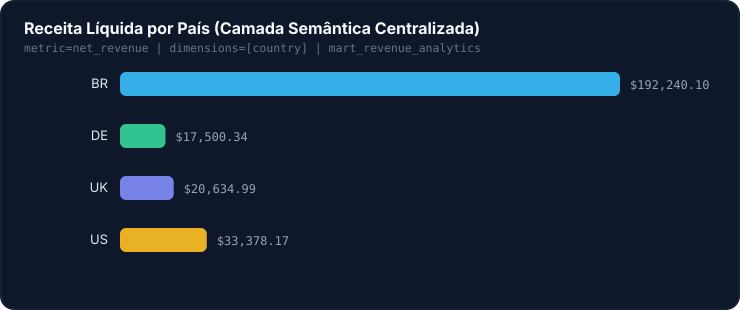
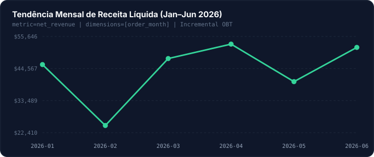
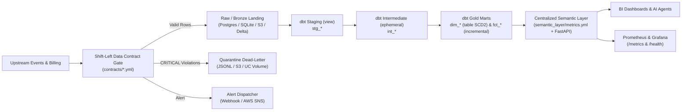

# Data Contracts & Semantic Layer Analytics Platform


A production-grade analytics engineering platform demonstrating **Shift-Left Data Contracts**, **Medallion + Dimensional Modeling (dbt Core + SCD Type 2)**, a **Centralized Headless Semantic Layer**, **Cloud Mirror IaC (AWS + Databricks)**, and **Full-Stack Observability & k6 Load Testing**.

> 🔍 **Recruiter Showcase & Live Evidence:**
> - 🌐 **[Interactive Showcase (`docs/index.html`)](docs/index.html)** — GitHub Pages ready dashboard built from real pipeline outputs.
> - 📄 **[Live Execution Proof (`docs/DEMO.md`)](docs/DEMO.md)** — Verified contract block/quarantine payload, 20/20 quality tests, SCD2 versioning, and governed semantic metrics.
> - 📐 **[Architecture & Materialization Trade-offs (`docs/ARCHITECTURE_TRADEOFFS.md`)](docs/ARCHITECTURE_TRADEOFFS.md)** & **[ADRs](docs/adr)**

---

## Visual Showcase (Real Pipeline Outputs)

| Net Revenue by Country (`mart_revenue_analytics`) | Monthly Net Revenue Trend (Jan–Jun 2026) |
| :---: | :---: |
|  |  |

---

## Architecture Overview



---

## Repository Structure

```text
data-contracts-semantic-platform/
├── shared_models.py                  # Core dataclasses & PlatformConfig (env-driven)
├── Dockerfile                        # Non-root multi-stage Python 3.12 runtime
├── docker-compose.yml                # postgres:16-alpine, pipeline-api, prometheus, grafana
├── requirements.txt                  # Python runtime & dbt dependencies
├── .env.example                      # Environment variable template
├── .github/workflows/ci.yml          # Compile, unittest, YAML/SQL/JSON, Docker & Terraform CI
├── infra/
│   ├── aws/
│   │   ├── main.tf                   # S3 zones, Glue Catalog, Redshift Serverless, Athena, SNS
│   │   ├── variables.tf
│   │   └── outputs.tf
│   ├── databricks/
│   │   └── workflow.json             # Lakeflow multi-task job (PySpark -> dbt -> DLT -> UC Views)
│   └── monitoring/
│       ├── prometheus.yml            # Scrape config for pipeline-api
│       └── grafana/provisioning/     # Auto-provisioned Prometheus datasource
├── tests/
│   └── load/
│       └── k6_semantic_api.js        # k6 load test (ramp-up, p95 < 250ms, error rate < 1%)
└── docs/
    ├── ARCHITECTURE_TRADEOFFS.md     # Deep-dive: materializations, contracts, SCD2, cloud parity
    └── adr/
        ├── 001-shift-left-data-contracts.md
        ├── 002-materialization-strategy.md
        └── 003-centralized-semantic-layer.md
```

---

## Quickstart

### 1. Local Containerized Stack (Docker Compose)

```bash
cp .env.example .env
docker compose up -d --build
```

Services exposed locally:
* **Semantic & Pipeline API:** `http://localhost:8000` (`/health`, `/docs`, `/metrics`, `/api/v1/semantic/metrics`, `/api/v1/semantic/query`)
* **PostgreSQL 16 Warehouse:** `localhost:5432`
* **Prometheus:** `http://localhost:9090`
* **Grafana:** `http://localhost:3000` (default credentials in `.env.example`)

### 2. Local Python Environment

```bash
python3 -m venv .venv
source .venv/bin/activate
pip install -r requirements.txt
python -m unittest discover -s tests -p "test_*.py" -v
```

### 3. k6 Load & Resilience Testing

Verify the Semantic API meets the `p(95) < 250ms` and `< 1%` error SLA under concurrent BI & AI agent traffic:

```bash
k6 run tests/load/k6_semantic_api.js
# Or target a remote staging endpoint:
BASE_URL=https://semantic-api.staging.example.com k6 run tests/load/k6_semantic_api.js
```

---

## Cloud Mirror (AWS & Databricks)

* **AWS Blueprint ([infra/aws/main.tf](infra/aws/main.tf)):** Mirrors local zones and warehouse into KMS-encrypted S3 (`raw`, `quarantine`, `curated`), AWS Glue Data Catalog databases, Redshift Serverless, an Athena Workgroup with FinOps scan cutoffs, and an Amazon SNS topic for Data Contract violation alerts.
* **Databricks Lakehouse ([infra/databricks/workflow.json](infra/databricks/workflow.json)):** Orchestrates PySpark contract validation → dbt Core medallion transformations → Delta Live Tables → governed Unity Catalog Metric Views.

---

## Architecture Documentation & ADRs

* [Architecture Trade-offs Deep Dive](docs/ARCHITECTURE_TRADEOFFS.md) — `ephemeral` vs `view` vs `table` vs `incremental` materializations, shift-left contracts, SCD Type 2 vs Type 1, centralized semantic layer, and local-to-cloud parity.
* [ADR-001: Shift-Left Data Contracts with Dead-Letter Quarantine](docs/adr/001-shift-left-data-contracts.md)
* [ADR-002: Layer-Specific Warehouse Materialization Strategy](docs/adr/002-materialization-strategy.md)
* [ADR-003: Centralized Headless Semantic Layer](docs/adr/003-centralized-semantic-layer.md)
